  

Terrawise is an interactive reference guide to major Indian soil types, the regions where they occur, and the crops associated with them. It brings soil profiles, crop-region exploration, and general agricultural reference notes into one visual experience.

  

## Features

- **Eight soil profiles** — Explore major Indian soil types through visual sections.
- **Search** — Find soil types, crops, regions, and related information.
- **Crop–region cross-check** — Explore matches in the site's simplified reference index.
- **Detailed reports** — Open searchable soil and crop reports for more context.
- **Interactive facts** — Discover short facts related to soils and agriculture.
- **Responsive experience** — Browse the guide on different screen sizes, with keyboard and reduced-motion support.

## Tech Stack

  

  
  

---

  <strong>Terrawise</strong> 
  <em>Know your soil. Grow smarter.</em> 
  Made by Johan Rohith

## Why Terrawise?

Soil characteristics and regional conditions are important context when learning about crops, but this information is often spread across separate references. Terrawise aims to make foundational soil and crop information easier to explore in one place, helping learners connect soil types, regions, and associated crops. It is an educational guide, not a substitute for field-specific advice from qualified agricultural professionals.

## How It Works

Explore the homepage's soil profiles or search by soil type, crop, or region, then open a detailed report for additional information. The crop–region cross-check uses a simplified built-in index, so a missing match indicates a gap in that index rather than proof that a crop cannot grow in a location.

